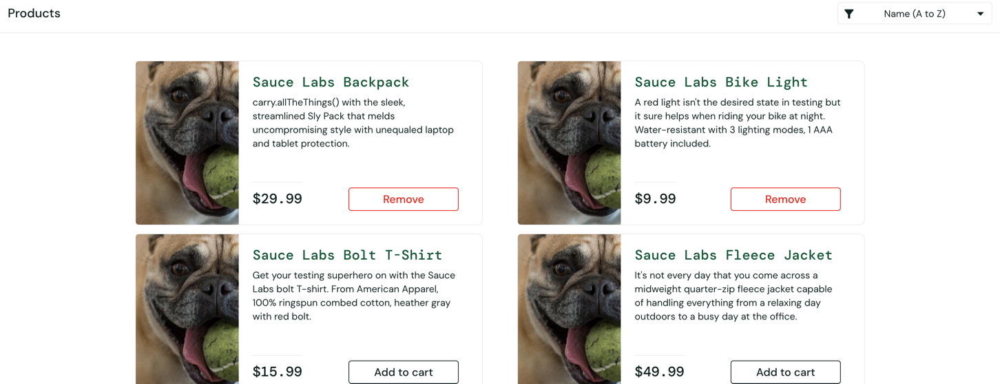
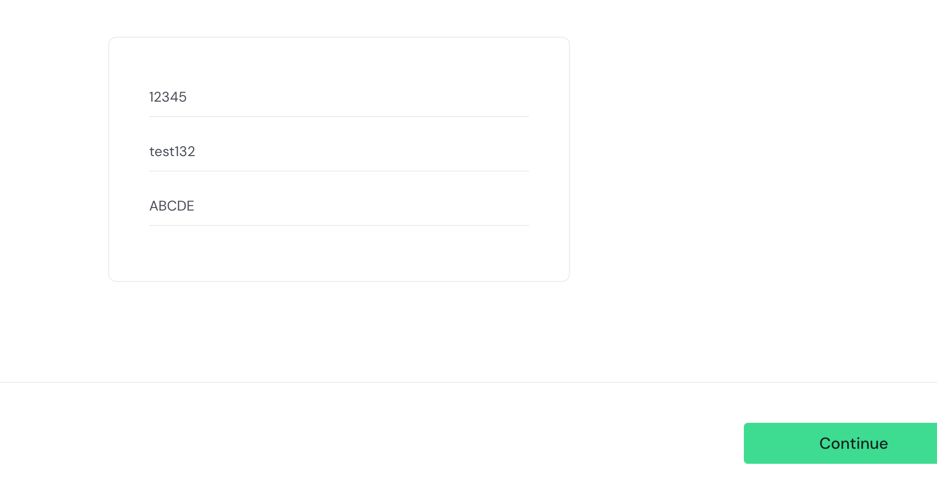
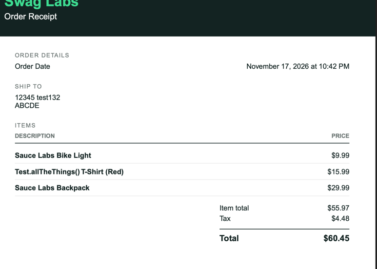

# Bug Reports - SauceDemo

## General Information

| Field | Description |
|---|---|
| Application | [SauceDemo](https://www.saucedemo.com/) |
| Testing Type | Manual Functional Testing |
| Browser | Google Chrome 158 |
| Operating System | macOS Sonoma |
| Test Environment | Public Demo Application |
| Test Accounts | `standard_user`, `problem_user` |

## Defect Summary

| Bug ID | Summary | Severity | Priority | Status |
|---|---|---|---|---|
| BUG-WEB-002 | Product sorting by price does not work for problem_user | Major | Medium | Open (portfolio finding) |

**Note:** The status refers to the finding documented in this portfolio, not to a defect officially registered or accepted by the SauceDemo development team.

---

## BUG-WEB-002: Products Are Not Sorted by Price (Low to High) for problem_user

**Severity:** Major  
**Priority:** Medium  
**Status:** Open (portfolio finding)  
**Type:** Functional Bug

### Environment

- Application: https://www.saucedemo.com/
- Browser: Google Chrome 158
- OS: macOS Sonoma
- Test account: `problem_user`

### Preconditions

1. The SauceDemo application is available.
2. The user is logged in with the `problem_user` account.
3. The Products page is displayed.

### Steps to Reproduce

1. Open the Products page.
2. Locate the sorting dropdown in the upper-right corner.
3. Select "Price (low to high)".
4. Observe the displayed product order and compare the prices.

### Expected Result

The products should be displayed in ascending order by price, from the cheapest to the most expensive.

### Actual Result

According to the recorded test execution, selecting "Price (low to high)" does not change the displayed product order.

The products are not sorted as expected.

### Impact

Users cannot reliably arrange products by ascending price when using the `problem_user` account.

This makes it more difficult to compare products by price and reduces the reliability of the sorting functionality.

### Severity Justification

**Major:** The sorting function does not perform its expected operation in the affected test account. Other application functionality remains available.

### Priority Justification

**Medium:** The issue affects product browsing but does not directly block login or checkout. The affected account is specifically used to demonstrate defects in the application.

### Attachments

### Additional Notes

The issue was documented using the `problem_user` demo account.

Product sorting by price was previously reported as working correctly for `standard_user`.

The issue should be rechecked during regression testing.

---

## Observations and Requirement Clarifications

The following behavior was observed during checkout testing. It has not been classified as a confirmed defect because formal input validation requirements are unavailable.

### OBS-WEB-001: Checkout Accepts Numeric Characters in Name Fields

**Status:** Requires Clarification  
**Related Checklist IDs:** WEB-25, WEB-26, WEB-27  
**Original Finding:** BUG-WEB-001

### Environment

- Application: https://www.saucedemo.com/
- Browser: Google Chrome 158
- OS: macOS Sonoma
- Test account: `standard_user`

### Preconditions

1. The user is logged in as `standard_user`.
2. At least one product is added to the shopping cart.

### Steps to Reproduce

1. Open the shopping cart.
2. Click "Checkout".
3. Enter the following data:
    - First Name: `12345`
    - Last Name: `test132`
    - Zip/Postal Code: `ABCDE`
4. Click "Continue".

### Observed Result

The application accepts the entered values and navigates to the "Checkout: Overview" page without displaying validation errors.

### Expected Behavior / Clarification Needed

The exact input validation rules are not specified.

The following questions should be clarified with the product owner or business analyst:

- Are numeric characters allowed in First Name and Last Name?
- Are there any restrictions on the format or length of these fields?
- Which countries and postal code formats must be supported?

### Reason for Classification

Numeric characters in name fields are not sufficient evidence of a defect without documented validation rules.

In addition, alphanumeric postal codes are valid in some countries.

Therefore, this behavior is documented as an observation rather than a confirmed software defect.

### Attachments

---

## Testing Notes

- Testing was performed on a public demo application.
- Formal functional requirements were not available.
- Confirmed functional issues and observations requiring clarification are documented separately.
- Severity and Priority are preliminary QA assessments.
- The findings have not been submitted to or verified by the application's development team.