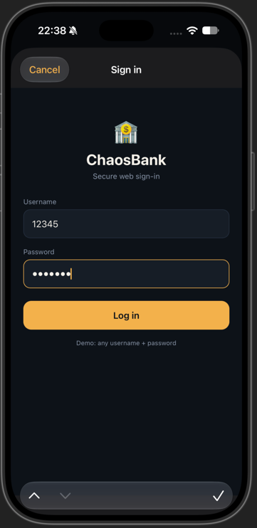
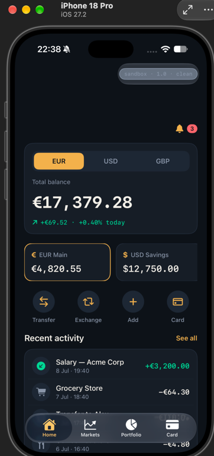

# Bug Reports and Observations - ChaosBank (iOS)

## 1. General Information

| Field | Description |
|---|---|
| Application | ChaosBank |
| Platform | iOS |
| Testing Type | Manual Mobile Application Testing |
| Device | iPhone 18 Pro (Simulator) |
| iOS Version | 26.3 |
| App Version | 1.0 |
| Test Environment | Xcode iOS Simulator |

## 2. Findings Summary

| ID | Summary | Type | Status |
|---|---|---|---|
| OBS-MOB-001 | Registration accepts a numeric-only username | Requirement Clarification | Needs Clarification |

**Note:** No confirmed defects are documented in this report. The observation below requires clarification of the application's requirements.

---

## OBS-MOB-001: Registration Accepts a Numeric-Only Username

**Type:** Requirement Clarification  
**Status:** Needs Clarification  
**Related Checklist ID:** MOB-05

### Environment

- Application: ChaosBank
- Device: iPhone 18 Pro (Simulator)
- iOS Version: 26.3
- App Version: 1.0

### Preconditions

The user is on the Sign Up screen.

### Steps to Reproduce

1. Open the ChaosBank application.
2. Navigate to the Sign Up screen.
3. Enter `12345` in the Username field.
4. Tap the Sign Up button.
5. Observe the registration result.

### Test Data

| Field | Value |
|---|---|
| Username | `12345` |
| Other required fields | Valid test data |

### Expected Behavior / Clarification Needed

The application's username validation requirements are not available.

The following questions should be clarified with the Product Owner or Business Analyst:

1. Are numeric-only usernames allowed?
2. Are there any restrictions on allowed characters?
3. What are the minimum and maximum username lengths?
4. Should the application display a validation error for numeric-only usernames?

If numeric-only usernames are prohibited by the requirements, the application should reject the value and display an appropriate validation message.

### Actual Result

According to the original test execution, registration was successful using the numeric-only username `12345`.

No validation error was displayed for the username.

### Reason for Classification

The application accepts numeric-only usernames, but this behavior cannot be classified as a confirmed defect without documented validation requirements.

Numeric characters are commonly supported in usernames.

Therefore, the finding is documented as a requirement clarification rather than a functional bug.

### Impact

The potential impact depends on the application's username requirements.

If numeric-only usernames are allowed, the observed behavior is expected.

If they are prohibited, the current behavior may indicate missing input validation.

### Attachments

**Screenshot 1 - Registration**

**Screenshot 2 - Registration result**

---

## 3. Testing Notes

- Testing was performed using Xcode iOS Simulator.
- No physical iOS device was used.
- Complete functional requirements were unavailable.
- The observation was not classified as a confirmed defect.
- No Severity or Priority was assigned because the issue requires clarification.
- Additional validation testing is recommended after the username requirements are confirmed.

## 4. Conclusion

One observation related to username validation was documented during ChaosBank registration testing.

The application accepted a numeric-only username without displaying a validation error.

Further clarification of the username requirements is necessary before this behavior can be classified as a software defect.